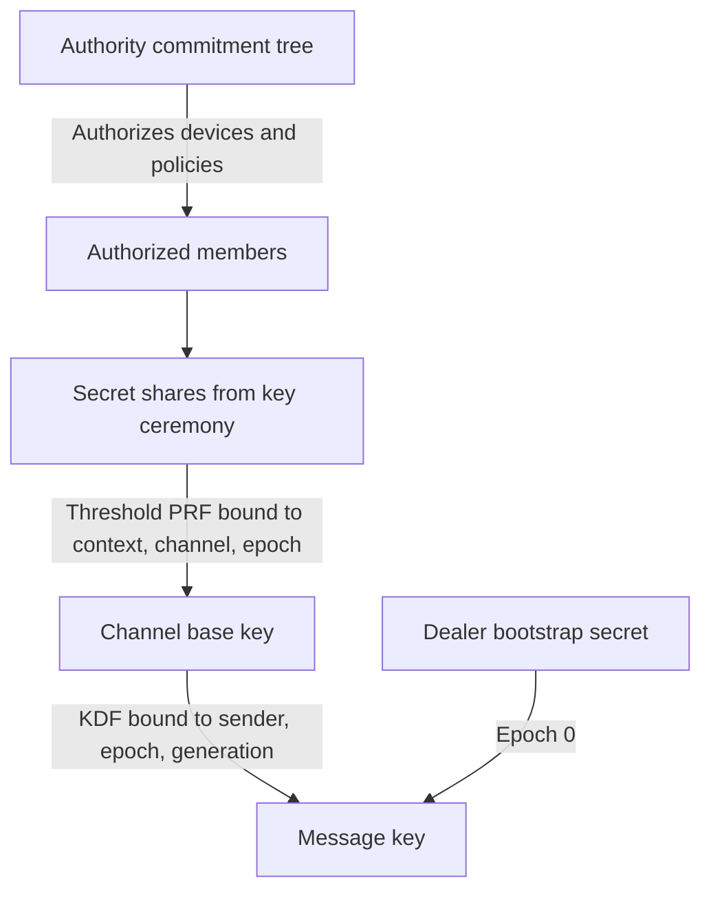
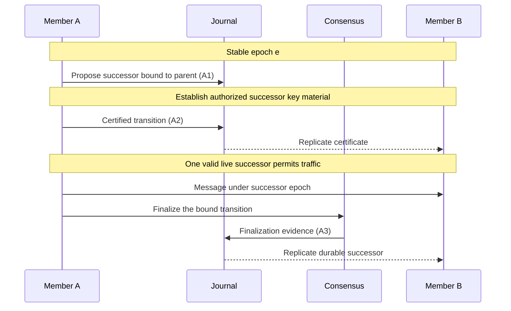

+++
title = "Recoverable Ratchets"
date = 2025-01-09
description = "Recoverable messaging, replicated identity, and selective agreement in Aura"
slug = "recoverable-ratchets"
draft = true
+++

Secure messaging joins cryptography with distributed state management. [MLS](https://www.rfc-editor.org/rfc/rfc9420.html) uses TreeKEM for group key agreement and sender ratchets for application messages. Concurrent updates, delayed delivery, device loss, and recovery require choices about how participants reconcile their views and retain secrets.

We approach these choices through Aura's distributed systems contract. The design described here targets recoverable messaging across replicated identities, with explicit boundaries between available message sends, certified transitions, and durable agreement.

## Background on Aura

In [Aura](https://github.com/hxrts/aura), multiple devices form a single authority. Shared facts replicate through CRDT journals, and relational contexts hold shared state between authorities. No central service orders every operation.

The Aura Messaging Protocol (AMP) combines deterministic reduction of those facts with separately protected secret material. Its recovery contract covers shared protocol state, authorized retained message history, and safe resumption of sending. Recovery and secret deletion must follow the same retention policy.

## Requirements

**Deterministic Recovery**

A recovering device reconstructs shared protocol state from replicated facts. Recovering decryption capability also requires authorized secret material, obtained through retained encrypted packages, surviving devices, or a recovery ceremony. Public journal facts alone cannot reveal confidential keys.

The recovery contract specifies which history remains recoverable and which secrets have deliberately been erased. A device must also obtain safe sending allocations before transmitting; reconstructing an old checkpoint must never permit reuse of an encryption key and nonce.

**Multi-Device Authorities**

An authority presents one messaging identity while managing its devices internally. Adding a device need not add another member to every external messaging group. This abstraction concerns protocol identity; transport observations can still disclose metadata.

Devices must support concurrent sends, including during partitions, without reusing a key and nonce. Their send allocations must remain disjoint across independent runtimes, crashes, and recovery. Merging journals later reconciles shared state, but cannot undo a cryptographic collision that already occurred.

**Selective Consistency**

Ordinary sends should remain available with valid keys, authorization, and an allocated sending range. Durable epoch changes require agreement bound to the exact parent state and successor. The protocol must distinguish a proposed transition, a certified live successor, and a durable successor.

Safety must hold through partitions. Progress requiring a quorum depends on sufficient authorized participants, available secret material, and the delivery assumptions in Aura's [distributed systems contract](https://hxrts.com/aura/004_distributed_systems_contract.html).

**Expressive Authorization**

Every outbound message passes capability, flow-budget, journal-coupling, and leakage checks before transport. Denied sends produce no outbound message. Budget allocations must remain safe when several devices send concurrently or become partitioned.

Accounting follows charge-before-send semantics. A network failure can occur after a durable charge, so retry and cancellation rules must state how that charge is treated. Successful remote delivery cannot be made atomic with a local journal update.

## Architectural Overview

AMP separates authority structure, channel key establishment, and message generations. Replicated facts identify the authorized state; secret material supplies the ability to encrypt and decrypt within that state.

### Key Hierarchy

Aura uses a commitment tree to represent an authority's devices and threshold policies. Leaves hold device signing shares, and branches express threshold requirements. The public root commitment binds the authority's structure without revealing its internal device roster.

Channel keys require a separate secret foundation. The bootstrap epoch uses a dealer-generated secret distributed to authorized recipients. Later channel epochs derive their base keys through a threshold PRF backed by the members' key ceremony; the public tree root is binding context and cannot supply the secret input.

Key evolution has three levels:

1. **Authority epochs** change authority key material and device policy. Healing a compromise of authority secrets also requires refreshing affected context secrets and removing the attacker's access.
2. **Channel epochs** establish fresh channel base keys and bind them to authorized membership. An attacker holding only an earlier base key must not be able to derive the refreshed successor key.
3. **Message generations** select message keys within an epoch. Their allocation prevents key/nonce reuse, while checkpoint windows bound ordinary out-of-order acceptance.

The bootstrap secret is distributed over authenticated encrypted channels and stored separately from public journal facts. Later epoch derivation combines verified partial evaluations from a threshold of participants. Once a device holds an authorized epoch base key, individual message derivation is local.

### State and Agreement

Journals retain monotone facts about checkpoints, proposals, certificates, finalizations, and conflicts. Reduction derives the stable epoch and any live successor from the available evidence.

An A1 proposal expresses a request and gives no authority to send under the successor. Exactly one valid, unsuppressed A2 certificate can expose a live successor for traffic. A3 consensus finalization establishes durability; the normal path finalizes the same transition that became live at A2.

Conflicting valid certificates suppress live successor exposure until explicit evidence resolves the conflict. Aura Consensus supplies agreement on an individual operation. Parent binding, transition validation, and sequencing compose those decisions into an epoch chain; independent consensus instances do not provide automatic global ordering.

### Ratchet Windows

Every checkpoint anchors two consecutive acceptance windows. For base generation `G` and window parameter `W`, window A spans `G` through `G+W`, and window B spans `G+W+1` through `G+2W`, with inclusive endpoints. Together they cover the interval from `G` through `G+2W`.

The default `W` is 1024. These windows tolerate delayed and reordered messages within the accepted range, including drift near checkpoint boundaries. They govern admission rather than the number of keys derivable from a captured secret.

Before sending, a device reduces the facts available to it, selects the authorized epoch, and reserves a unique sending generation. It derives a message key bound to the secret base key, context, channel, sender, epoch, and generation. The authenticated data binds the message header and sender, and the guard chain authorizes transport.

Epoch overlap is policy-dependent. Normal and additive transitions permit stable-plus-successor overlap; removal and emergency transitions apply stricter acceptance rules. Historical decryption is a separate policy decision and must not let retained keys bypass sender exclusion or emergency traffic restrictions.

### Security and Retention

A device holding an epoch base key can derive that epoch's message keys from their public identifiers. Deleting a checkpoint or rejecting an old generation does not remove this ability. AMP therefore treats the epoch secret and its recoverable copies as the confidentiality boundary for retained history.

Post-compromise healing requires fresh material unavailable to the attacker. Refreshing a channel can heal exposure of its old base key, provided the attacker no longer has authorized access to the new secret. Compromise of threshold shares or recovery credentials requires a stronger refresh and exclusion procedure; incrementing an epoch number is insufficient.

Retention policy determines which earlier epochs remain readable. Emergency cryptoshred must remove the covered secrets and every retained route for reconstructing them, including recovery packages and relevant cached derivation material. It cannot protect plaintext or keys already copied by an attacker.

This makes recovery an explicit trade-off. Retaining a secret preserves recoverable history and also preserves the exposure associated with that secret. Per-message forward secrecy would require an additional evolving-secret and deletion design, together with a compatible recovery horizon; it does not follow from generation-indexed key derivation.

### Epoch Lifecycle

Routine bumps become eligible when the current generation is at least `W/2` beyond the canonical checkpoint's base generation. With default settings, this minimum spacing is 512 generations. Eligibility is not a promise to rotate every 512 messages, and emergency transitions can bypass the spacing rule.

Successor traffic requires both valid agreement evidence and the corresponding authorized secret material. Certification permits traffic before durability, while conflicts can suspend that permission. Quorum-dependent transitions can stall during partitions even while eligible ordinary sends remain available.

### Recovery

Recovery first restores authority credentials and access to the appropriate replicated facts. Reduction reconstructs the stable epoch, any live transition, checkpoints, and policy. Authorized secret recovery then restores the retained decryption capability, potentially through interaction with other participants.

Before sending resumes, the device establishes a fresh or safely restored allocation that cannot collide with earlier sends. Missing secrets, unavailable participants, and deliberately erased history have distinct outcomes. A journal checkpoint establishes protocol position; it does not establish possession of keys or permission to reuse a sending generation.

## Comparison with Existing Protocols

### MLS

MLS supports concurrent application messages through separate sender ratchets and explicitly handles delayed and reordered delivery. Its epoch-changing commits require sequencing and a strategy for conflicting commits. A Delivery Service can assist with this coordination, but the protocol does not require every application message to pass through a centralized total order.

MLS also specifies deletion of secrets to obtain forward secrecy. Restoring access to deleted message keys would change that security contract. Aura instead makes authorized history retention and recovery explicit parts of its messaging design. See [RFC 9420, sections 9, 14, and 15](https://www.rfc-editor.org/rfc/rfc9420.html).

### BeeKEM and Keyhive

[BeeKEM](https://www.inkandswitch.com/keyhive/notebook/02/) handles concurrent tree updates by retaining conflict keys and integrating their contributions through causally subsequent updates. That reconciliation is part of the protocol. It supports local-first collaboration without requiring a single agreed successor before every update can proceed.

Keyhive combines this with a delegable access-control graph and effects such as pull, read, write, and admin. Aura uses its capability language and flow-budget enforcement as a broader application contract. The distinction is the authorization semantics and their integration with messaging, rather than the presence or absence of delegation.

BeeKEM's authors also distinguish its forward secrecy from Keyhive's document-history policy: retaining the ability to read earlier document chunks changes the application's secrecy properties. Aura must make the same distinction between key establishment and retained history.

### Amigo

[Amigo](https://spacelab-ccny.github.io/research/amigo/) targets mesh messaging under intermittent connectivity and uses a causal TreeKEM construction. Its authors describe both forward secrecy and post-compromise security. Causal reconciliation allows progress without requiring consensus on every key update.

AMP chooses certified live transitions and consensus-backed durability for its channel state. This introduces coordination requirements in exchange for an explicit durable successor decision. Neither agreement nor causal convergence can make disconnected devices learn a cutoff instantly, or erase secrets already held by an adversary.

### Why AMP?

AMP's distinctive contract combines authority-level device abstraction, deterministic shared-state reduction, authorized secret recovery, and selective agreement. Ordinary messages can proceed using valid local authority, while transitions distinguish provisional requests, live certificates, and durable decisions.

The essential comparison is which state must converge, which decisions require agreement, and which secrets remain recoverable. Those choices determine availability, exposure, and the history a user can regain after losing devices.

## Conclusion

Recoverable messaging requires cryptography, replicated state, and secret retention to share one contract. Facts reconstruct the protocol view. Protected secret material restores decryption capability, and safe sending allocations prevent recovery from repeating an encryption key and nonce.

AMP applies different agreement requirements to ordinary sends and epoch transitions. Its windows tolerate asynchronous delivery; its key-refresh and retention policies define compromise recovery and historical exposure. Keeping those responsibilities explicit makes the recovery promise precise.

## See Also

- [Aura Messaging Protocol Specification](https://hxrts.com/aura/112_amp.html)
- [System Architecture](https://hxrts.com/aura/001_system_architecture.html)
- [Authority and Identity](https://hxrts.com/aura/102_authority_and_identity.html)
- [Journal System](https://hxrts.com/aura/105_journal.html)
- [Relational Contexts](https://hxrts.com/aura/114_relational_contexts.html)
- [Distributed Systems Contract](https://hxrts.com/aura/004_distributed_systems_contract.html)
