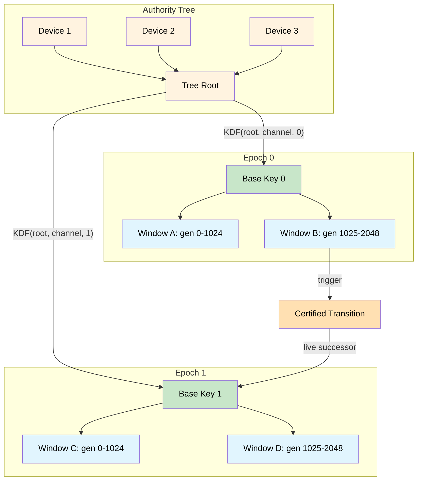

+++
title = "Patterns for P2P Resilience"
date = 2025-03-20
description = "Design patterns for resilient encrypted P2P networks"
slug = "p2p-resilience"

[extra]
cover_image = "/images/pixillation.jpg"
cover_caption = "<em>Pixillation</em>, Lillian Schwartz and Ken Knowlton (1970)"
+++

## Introduction

In December I attended [Splintercon](https://splintercon.net/paris/) in Paris, a conference organized by eQualitie and my friends [Katerina Kataeva](https://k-k.work/) and [Lai Yi Ohlsen](https://www.laiyiohlsen.com/). The focus of the event was so-called "Splinternets," isolated portions of the internet, often created by repressive governments. The conference included in-depth presentations on Chinese and Russian internet censorship regimes, from backdoored cryptography and state-sponsored botnets to hardware exports and foreign policy. In light of recent events, there was also a special focus on Iran's proliferating internet censorship apparatus.

The event brought together academic researchers studying internet shutdowns, investigative journalists reporting on mass surveillance, human rights advocates, representatives from prominent internet infrastructure companies, and a contingent of engineers building encrypted P2P networks and mesh networking tools.

Out of necessity, private, P2P, and mesh technologies are starting to see real adoption in places like Iran. However, conversations at the event revealed large gaps that need to be bridged before bottom-up networks can survive internet shutdowns reliably. These are highly asymmetric environments where the regime controls physical infrastructure, monitors transmission channels, and mounts large-scale disinformation campaigns.

I've been building a variety of P2P research prototypes for the past few months, and the conference gave me a window into the real challenges of deploying systems in times of crisis.

In this post I'll highlight a few software patterns from my recent experiments that could be of interest to developers working on encrypted P2P protocols that aim to resist internet censorship.

*These prototypes prioritize research value over practicality. Production systems have to care about robustness and reliability in ways that research prototypes don't. The constraints I chose for experimentation have nevertheless shaped the design in useful ways, and the resulting choices are worth explaining on their own terms.*

## Beyond Local-first

Aura starts with several under-studied design considerations, which the system takes as strict constraints:

1. The network topology is fully P2P, no dedicated servers, no DNS, no central software distribution authority
2. The system must be robust to intermittent connectivity and device loss
3. All channels are E2E encrypted with bounded forward secrecy

The [local-first](https://www.inkandswitch.com/essay/local-first/) paradigm treats devices as authoritative for state and identity. Once we assume any combination of devices can be lost or compromised, authority must live in the network rather than on a device. A CRDT resolves concurrent data updates, but authority changes fall outside that scope. Changing membership, rotating keys, or transferring ownership requires bounded agreement before dependent operations can proceed.

My last post, [Triangle of Forgetting](/post/triangle-of-forgetting/), sharpens this tradeoff: monotone convergence, temporal secrecy, and dynamic membership cannot be jointly guaranteed. Aura addresses the authority leg with threshold signatures, so an authority can be one actor with many devices or many actors acting as one.[^authority] Facts grow by join, and capabilities shrink by meet. Every operation must satisfy both, preserving CRDT-style availability where it fits.

## Web of Trust

In a fully P2P system all services must be provisioned by peer nodes. Readers familiar with Secure Scuttlebutt can appreciate the effectiveness of marrying the social graph with a networking service. Aura extends the same web of trust model to provision additional services, including:

- Discovery - Find peers through the social topology
- Replication - Relay encrypted packets and store shared data
- Authority - Administer groups and recover through the social network

## Servers Without Servers

The pattern is to replace dedicated infrastructure with socially scoped availability domains. The system asks nearby trusted peers to provide relay, storage, and discovery for one another, which changes the trust model. Peers become semi-trusted infrastructure. They learn timing, availability, routing, and social-proximity information, while encrypted content stays opaque.

The advantage is resilience. A network keeps functioning when DNS, app servers, or centralized distribution points disappear. Discovery can start with direct relationships, expand through nearby trust edges, and fall back to peripheral rendezvous only as a last resort.

The tradeoff is a new privacy surface. Aura separates service trust from communication privacy. Social relationships decide who may provide a service, while opaque envelopes, selectors, cover traffic, and abstract service interfaces limit what providers learn about the communication graph.

## Composing Protocols

Aura brings together distributed key generation, key resharing, BFT consensus, rendezvous, and authority management. These protocols need to compose well and remain upgrade-safe, especially on networks with heterogeneous software versions. Race conditions, deadlocks, and ordering bugs are easy to introduce and hard to detect. Aura uses choreographic programming so these protocols are correct by construction.

A choreography describes a protocol from a global perspective, capturing the complete interaction between participants. The compiler projects this global view into local implementations, so the pieces fit together correctly. A well-formed global choreography guarantees that no local projection deadlocks or waits on messages that never arrive.

This inverts the typical pattern of writing each participant independently and verifying correctness through testing. You design the coordination once, and the tooling generates implementations guaranteed to interoperate. Choreographies produce session-typed channels, where the session type specifies the exact sequence of messages. The type checker ensures each participant adheres to the protocol.[^choreography]

## Safe Protocol Evolution

A censored P2P application cannot assume a central app store will push a fix. Upgrades propagate through the same P2P topology as everything else, so peers end up running different versions at different points in a protocol's lifecycle.[^maintenance] Without formal guarantees on how versions compose, an application can silently break, become unrecoverable, or violate its own protocol invariants. The developer cannot observe the failure or deploy a fix.

Aura addresses this with two formally verified primitives. The `link` operation safely combines protocols at build time, and `delegate` transfers session endpoints at runtime. Both preserve *coherence*, ensuring agreement between channel endpoints about the next message. The Reconfiguration Harmony theorem proves that local behavior stays consistent across upgrade boundaries.

These guarantees live in [telltale](https://github.com/hxrts/telltale), a multi-party session types library mechanized in Lean 4. Unusually for session-types work, telltale is both formally verified and deployable. Aura uses it to keep upgrade guarantees intact in networks developers cannot reach.

## Bounded Agreement

Most state syncs via CRDTs, but some changes need bounded agreement before anything else can proceed. Adding a member, rotating keys, or binding a guardian relationship all change the cryptographic context that everything else depends on.

Aura Consensus provides single-shot agreement for these changes. Each instance agrees on one thing, binds to a single prestate, and produces a single commit fact. Once the cryptographic context is established, keys derive deterministically from shared state and sync via CRDTs.

The protocol has two paths. The fast path completes in one to two round trips when all witnesses are online. The fallback path triggers on disagreement or initiator stall, using leaderless gossip where any witness can drive completion. Commits bind to explicit prestates, preventing forks and replays.

## The Ratchet Problem

Secure messaging is usually framed as a cryptography problem. But when state and identity are distributed across nodes with no central coordinator, it becomes a distributed systems problem. Protocols like MLS assume a delivery service for ordering, and Signal-style ratchets assume device-local state with complex multi-device synchronization. Aura works without either assumption while remaining fully recoverable from replicated state.

Aura has different requirements. All ratchet state must be deterministically recoverable from replicated facts, with no device-specific secrets. All devices must converge to the same ratchet position after syncing, and out-of-order delivery must work without head-of-line blocking.

Aura uses a dual-window ratchet that maintains overlapping valid ranges across transitions. Message sends use CRDT merge for availability. Epoch bumps use a certified single-winner transition, letting one successor become live before later consensus makes it durable. Removal and emergency transitions can instead require stricter cutover.[^amp]

## Deterministic Recovery

If state can be lost, it will be lost. Aura designs for recovery from first principles.

For messaging, this means trading per-message forward secrecy for deterministic recovery. Signal-style ratchets derive keys from processing history and store skipped keys explicitly for out-of-order messages. Aura derives keys deterministically from replicated journal state, able to rederive any key within the skip window without tracking which messages were skipped. Recovery proceeds without coordination by loading journal facts, reducing them to current state, and rederiving keys.

For identity, recovery relationships are cryptographic. A guardian binding captures commitment hashes, recovery parameters, and the consensus proof that both parties agreed. The recovery delay (24 hours by default) gives the account owner time to challenge fraudulent recovery attempts. When a guardian approves recovery, they create a grant capturing the old and new commitments, the operation, and the consensus proof.

## Nothing to See

If an attacker can observe failures, they can probe capabilities by watching what gets rejected. To preserve privacy, denied operations should be invisible.

Aura enforces this by checking everything locally before sending. Before any message crosses the network, it passes through a guard chain of capability verification, flow budget charging, journal coupling, and leakage tracking. If any check fails, the operation is blocked with no packet emitted. An observer cannot distinguish "operation denied" from "operation never attempted."

Aura tracks metadata exposure separately from the flow budgets used to limit spam. Relationship peers see content by consent, while gossip neighbors see only encrypted envelopes. External observers see network patterns. Exhausting an observer class's budget blocks further exposure to that class until its budget refreshes.

## Radiating

The patterns above follow from hard constraints on infrastructure, recovery, and privacy. Aura combines zero reliance on dedicated servers, robustness to device loss, and E2E encryption with bounded forward secrecy. These constraints reflect the adversarial conditions placed on mesh networks and P2P protocols during internet shutdowns.

Aura is free and open source. All core operations are functional, though some areas still need polish. If you are building in this space, I encourage you to try the software or incorporate these ideas into your own project. My hope is that Aura can help inspire more resiliant patterns in deployed networks that need to operate in adverse environments.

---

[^authority]: [Authority and Identity](https://hxrts.com/aura/102_authority_and_identity.html), covers threshold signatures and account authority model.
[^choreography]: [MPST and Choreography](https://hxrts.com/aura/110_mpst_and_choreography.html), covers session types and choreographic programming.
[^maintenance]: [Distributed Maintenance](https://hxrts.com/aura/116_maintenance.html), covers peer-to-peer update propagation and upgrade activation.
[^amp]: [AMP Protocol](https://hxrts.com/aura/112_amp.html), covers dual-window ratcheting and epoch transitions.
