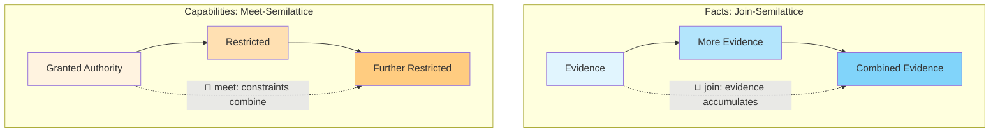
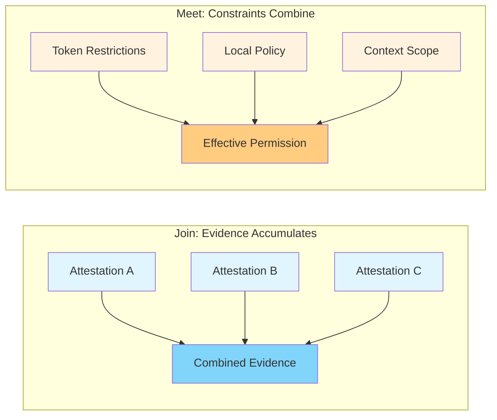
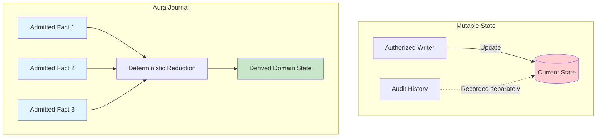
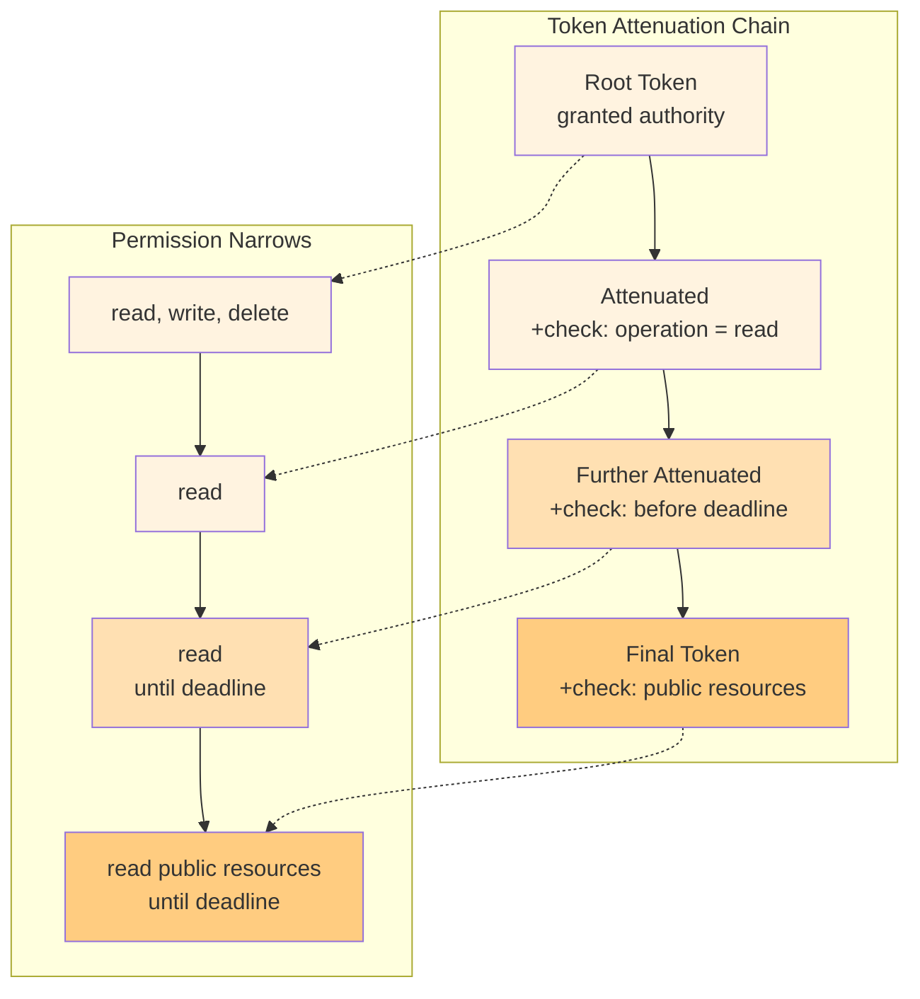
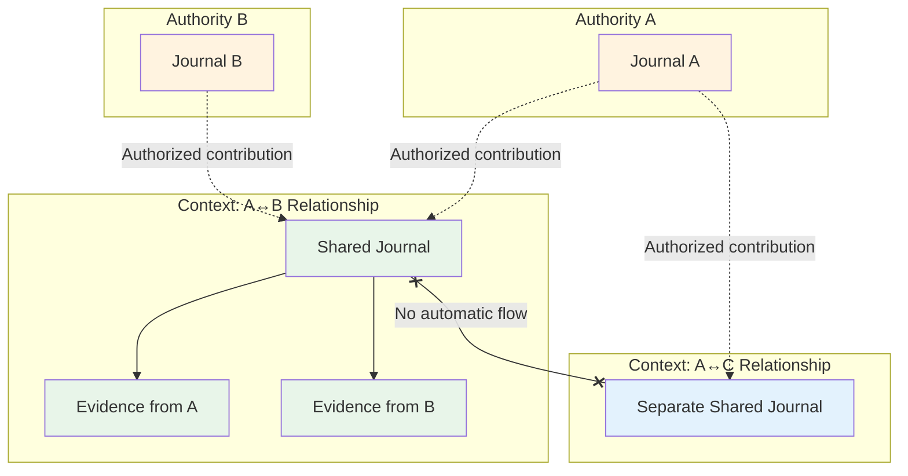
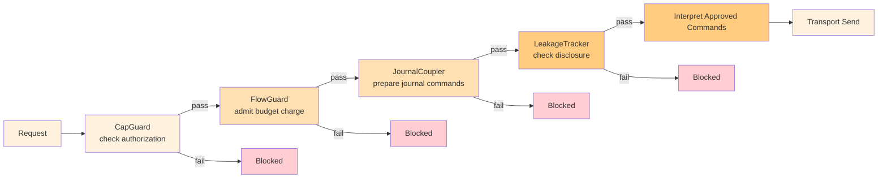
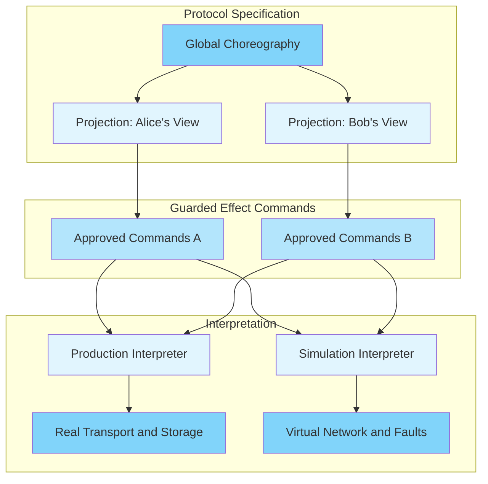
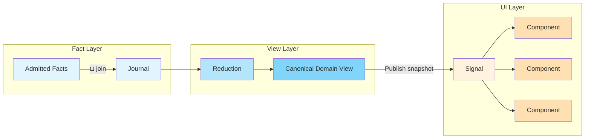
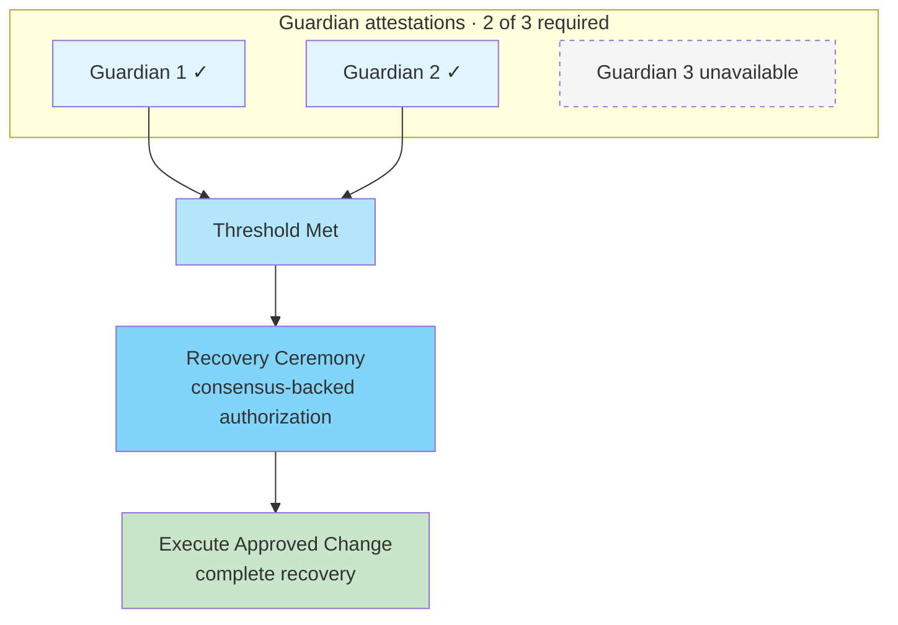
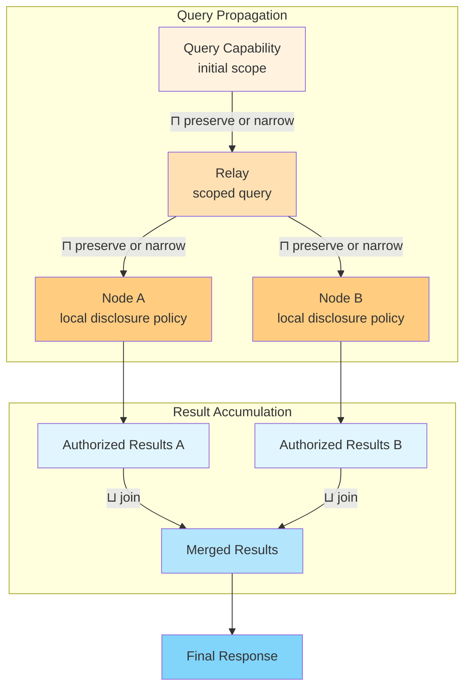

+++
title = "The Shape of Authority"
date = 2025-01-09
description = "How evidence, capabilities, and explicit agreement shape consent in Aura"
slug = "shape-of-authority"
+++

How far should authority travel when it changes hands? You can narrow permissions or pass them along, while broader authority requires a new grant. Evidence follows a different trajectory, accumulating as participants contribute attestations and decisions.

Aura expresses these directions through semilattices, mathematical structures that let replicas combine information predictably. Authentication and policy determine which evidence and grants the system admits. Together, these rules connect authorization, shared state, and recovery.

## Two Directions

A semilattice has an associative, commutative, idempotent binary operation. Regrouping inputs or changing their order preserves the result. Combining an element with itself changes nothing.

A join-semilattice supplies a least upper bound under its chosen order. For fact sets ordered by inclusion, join is union. A meet-semilattice supplies a greatest lower bound. For permissions ordered by inclusion, meet is intersection.

These operations give evidence and authority different trajectories. Replicas contribute facts through union, while capability composition preserves every applicable restriction. Two tokens from the same issuer may carry unrelated conditions. Their intersection depends on those conditions rather than token length.

## Evidence and Derived State

Aura journals retain facts within an authority or relational context. Admission checks establish the provenance and authorization each fact type requires. Deterministic reducers turn admitted evidence into application state.[^journal]

Replicas converge when they receive the same evidence and apply the same rules. Some decisions require agreement before their finalization facts can be admitted. Growing evidence can still shrink an active roster or revoke a permission.

The journal supports accountable interpretation by recording evidence for authorized transitions. Compaction replaces older facts with validated summaries that preserve the required meaning. This permits bounded storage while retaining the evidence needed to check decisions.

## Logical Authorization

Aura uses Biscuit tokens to carry verifiable grants and Datalog checks.[^biscuit] Holders attenuate tokens by appending restrictions. Signature chains protect existing blocks, and Datalog scoping limits which assertions carry issuer authority.

Authorization combines a trusted issuer key, request facts, and local policy. Every request must satisfy both token checks and authorizer policy. Broader permissions require a separately authorized grant.

Aura also uses Datalog for journal queries. A shared logic engine helps compose queries and policy, with trusted inputs and bounded evaluation at each boundary.[^authorization]

## Context Boundaries

What you share with your doctor differs from what you share with your employer. Aura expresses these relationships through separate contexts, each with its own namespace, journal, and capability frontier.

Cross-context transfers require permission under the source's disclosure policy and the destination's admission policy. A bridge protocol checks both, including when one device participates on both sides.

Opaque context UUIDs keep participant identities out of the identifier itself. Traffic patterns can still support correlation. Disclosure policy therefore works alongside transport privacy and metadata controls.

## The Guard Chain

Application sends pass through capability, budget, journal-coupling, and leakage checks before transport. Guards evaluate a prepared snapshot and produce commands for an interpreter to execute.[^authorization]

Guard denial blocks the outbound message. Execution errors preserve any accounting and recovery obligations already incurred.

Charging precedes sending, so transport can fail after a durable charge. Explicit operation identities and retry rules preserve accurate accounting. Each path that releases protected information needs an enforced authorization boundary.

## Explicit Effect Commands

Effect interfaces let the same protocol decisions run against different handlers. Command-producing boundaries represent approved work as data for an interpreter.

A protocol can prepare a `SendEnvelope` command and submit it to the relevant guards. Production handlers use real transport and storage. Simulation handlers use controlled networks and fault schedules.

Commands also support auditing. Where policy requires a durable record before an external effect, the interpreter persists it first. A persistence failure blocks the covered effect.

## Reactive Propagation

Aura's reactive pipeline connects admitted facts to domain views and interface signals. Reducers interpret evidence, and views publish updated snapshots.

Signal revisions advance while their values can shrink or change. A departure removes a contact, a revocation withdraws permission, and finalization can replace a provisional result. Authoritative entities remain tied to the evidence required to create them.

Pending actions and local interface state remain distinguishable from committed domain state. Subscribers recover from missed updates by reading a fresh snapshot. Observation failures remain explicit errors.

## Recover Identity Through Your Social Graph

Aura recovery uses guardians designated through an authorized setup protocol. Guardian policy sets eligible participants, scope, and the required threshold. Authenticated attestations bind each guardian's approval to a particular request and policy.

Distinct eligible attestations make the request eligible for a recovery ceremony. Consensus-gated transitions establish durable authorization for the approved membership or key change. Successful execution completes recovery.

The interface can show sufficient attestations while the ceremony remains pending. It reports completion after the authorized action succeeds.

## Consentful Search

The same algebra suggests a search design. A query capability limits resources, purpose, and forwarding scope. Relays preserve these constraints and may narrow them further.

Each answering node applies its local disclosure policy. Admitted results can merge through union when their identities support deduplication. Permission to ask leaves recipients free to withhold an answer.

Budgets constrain traffic and repeated disclosure. Surveillance resistance also needs controls for colluding relays, query correlation, multiple identities, and retained results. Those risks belong in the surrounding protocol's threat model.

## Structural Limits on Authority

A constitution establishes legitimate authority and procedures for changing it. Aura gives these concerns a technical expression through verifiable evidence, bounded delegation, and explicit agreement. Trusted keys and enforced boundaries connect those rules to the people authorized to act.

Participants can inspect the evidence behind a decision and the limits attached to a grant. Mathematics makes these commitments precise enough to verify. Infrastructure can then support authority that remains accountable as it passes between people.

---

[^journal]: Aura, [Journal](https://hxrts.com/aura/105_journal.html). Fact admission, reduction, and snapshot compaction.
[^biscuit]: Eclipse Biscuit, [Specifications](https://doc.biscuitsec.org/reference/specifications) and [Datalog](https://doc.biscuitsec.org/reference/datalog.html). Token attenuation, signature chains, and block scoping.
[^authorization]: Aura, [Authorization](https://hxrts.com/aura/106_authorization.html). Capability evaluation, sovereign policy, and guard integration.
