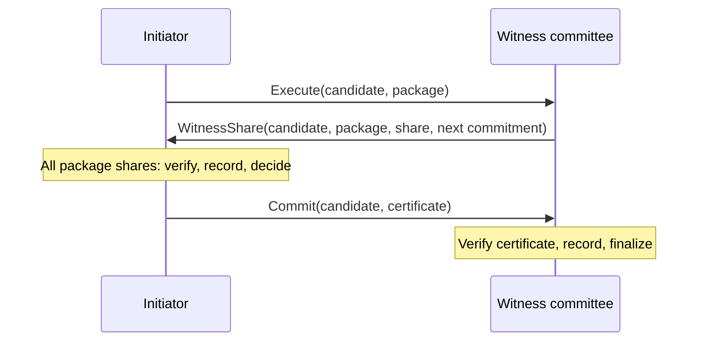

+++
title = "Aura Consensus"
date = 2025-01-09
description = "Fast authorization and resilient coordination for small peer-to-peer groups."
slug = "aura-consensus"
draft = false

[extra]
cover_image = "/images/manhattan-transcripts.jpg"
cover_alt = "The Manhattan Transcripts, Bernard Tschumi Architects (1976-1981)"
cover_caption = "The Manhattan Transcripts, Bernard Tschumi Architects (1976-1981)"
+++

Losing a device should not mean losing an account, and taking over one device should not grant control of an identity. Aura distributes account authority across devices and trusted relationships to make both failures survivable.[^architecture] A sensitive change therefore requires agreement among peers who may connect only intermittently. How can that agreement feel immediate when they are available and remain achievable when coordination is interrupted?[^consensus]

These decisions place two demands on the protocol. When witnesses are available and agree on the starting state, authorization should take one round trip after warm-up. When an initiator disappears or communication breaks down, authenticated contributions should remain available for peers to recover and combine. Aura therefore optimizes the fast path for latency and the fallback for resilience to interrupted coordination.

Both paths produce a verifiable commit fact for one operation and its prestate. That fact enters the same convergent journal as other updates. Coordination stays scoped to the decision, while the surrounding system continues to support offline work.

## Consensus as Fact Emission

A commit fact records agreement in a form that peers can verify and merge into their journals. Each instance uses a context-scoped witness committee with shared threshold key material. Here, `rid = H(operation, prestate)` identifies the candidate through its operation and starting state. The committee and its key remain fixed for the instance.

```haskell
struct CommitFact {
    cid: ConsensusId,
    prestate_hash: Hash,
    operation_hash: Hash,
    rid: ResultId,
    threshold_signature: ThresholdSignature,
    group_pubkey: GroupPublicKey,
    attester_set: Set[AuthorityId],
}
```

The signature binds the instance, operation, prestate, and result under the expected committee key. A verifier resolves that key from trusted context state and checks any key carried by the fact against it. Domain separation and context and epoch binding keep certificates scoped to their intended use.

Both paths terminate in the same kind of certificate, subject to the same acceptance conditions. A recipient verifies the decision regardless of which peer assembled it. Agreement ensures that valid certificates for one instance identify the same candidate, even if their signatures or attester sets differ. Once accepted, these records persist under CRDT merge and bring replicas into convergence.

## Witnesses and Quorums

Let `W` contain `n` witnesses, with at most `f` Byzantine members and a signing threshold `t`. Byzantine witnesses may send conflicting messages or withhold their shares. Honest witnesses validate the operation and prestate, then sign at most one candidate per `cid`, including across different prestates. This restriction survives timeouts, fallback, and restarts.

The threshold must ensure that any two signing quorums intersect in at least one honest witness. Completion without Byzantine cooperation also requires enough honest witnesses to meet the threshold:

$$
2t > n + f, \qquad t \leq n - f.
$$

For example, a committee of four witnesses can tolerate one Byzantine member with a threshold of three. Any two groups of three share at least two members, so at least one shared member is honest. That witness's single-candidate rule prevents conflicting certificates. These conditions protect agreement across both the fast path and fallback.

## Low Latency on the Fast Path

The fast path concentrates coordination in an initiator to minimize the exchange needed for a decision. Witnesses validate the proposed operation and prestate, then return shares for the deterministically computed candidate. The initiator combines compatible shares into a certificate and broadcasts the recorded commit fact. Other witnesses finalize after verifying it.

FROST threshold signing normally requires a nonce-commitment exchange before the signing exchange. Aura pipelines commitments by attaching each witness's next commitment to its current signature share. After warm-up, the initiator can include the cached commitments in the next proposal and collect shares in one round trip. Fresh, single-use nonces and invalidation on committee or key changes preserve the signing boundary.

The diagram shows the steady-state exchange and its two decision points. The committee lifeline groups recipients together, with shares returned by every signer in the selected package. Without usable cached commitments, the protocol first performs a separate commitment exchange.



### An Abstract Model

The pseudocode describes the target design at the level of candidates and certificates. `candidate` abbreviates the bound instance, operation, prestate, and result identifiers. Each `package` identifies a FROST signing package with a fixed signer set and nonce commitments. New instances start with empty collections and false decision flags, while restarts restore durable signing and commit records.

Share validation checks the candidate binding, committee membership, and the signer's contribution under that package. `CompleteShares` requires a valid share from every signer named in the package, with at least `t` distinct signers. Signatures from different packages remain separate even when they concern the same candidate. The model leaves nonce management, encoding, and message delivery to the surrounding protocol.

```haskell
-- Initiator
Start(operation, prestate):
    cid := fresh_consensus_id()
    candidate := Bind(cid, operation, prestate)
    package := PrepareSigningPackage(candidate)
    RegisterInstance(candidate, package)
    Broadcast Execute(candidate, package) to W

On WitnessShare(candidate, package, witness, share):
    cid := candidate.cid
    If not KnownInstanceAndPackage(candidate, package):
        return
    If ValidShare(candidate, package, witness, share):
        shares[candidate, package][witness] := share
    If not decided[cid] and CompleteShares(package, shares[candidate, package]):
        certificate := CombineShares(package, shares[candidate, package])
        AcceptCommit(candidate, certificate)

-- Witness
On Execute(candidate, package):
    cid := candidate.cid
    If not decided[cid]:
        If ValidateOperationAndPrestate(candidate) and ValidPackage(candidate, package):
            If HasStoredVote(cid, candidate, package):
                ResendStoredVote(cid, candidate, package) to initiator
            Else if ReserveSigningChoiceOnce(cid, candidate, package):
                share := ProduceShare(candidate, package)
                vote := AuthenticatedVote(candidate, package, self, share)
                PersistVote(vote)
                proposals[cid] := proposals[cid] ∪ {vote}
                Send WitnessShare(candidate, package, self, share) to initiator
        Else:
            Send StateMismatch(cid) to initiator
        StartFallbackTimer(cid)

On Commit(candidate, certificate):
    AcceptCommit(candidate, certificate)

-- Shared by initiators, witnesses, and fallback aggregators
AcceptCommit(candidate, certificate):
    cid := candidate.cid
    If not decided[cid] and ValidCertificate(candidate, certificate):
        PersistCommit(candidate, certificate)
        decided[cid] := true
        StopFallbackTimer(cid)
        StopGossipTimer(cid)
        Broadcast Commit(candidate, certificate) to W

On FallbackTimer(cid):
    If not decided[cid]:
        StartGossipTimer(cid)
        CheckProposals(cid)
```

The initiator may also be a witness, with its own vote subject to the same rules. `ReserveSigningChoiceOnce` atomically persists a signing reservation before producing a share, and retries resend the stored vote. Handlers execute serially per instance, and starting an active timer preserves its existing deadline. Certificate verification checks the complete binding against the expected committee and threshold.

## Evidence Propagation

Equivocation occurs when a witness authenticates votes for different candidates under the same instance ID. An equivocation proof contains both conflicting votes and the material needed to verify their origin. Each vote authenticates its full candidate binding, including its prestate. This makes conflicting votes independently checkable by other peers.

```haskell
EquivocationProof = {
    witness: AuthorityId,
    cid: ConsensusId,
    first_vote: AuthenticatedVote,
    second_vote: AuthenticatedVote,
}

MergeEvidence(delta):
    For each proof in delta:
        If VerifyEquivocationProof(proof):
            evidence := evidence ∪ {proof}
```

Evidence travels as deltas attached to protocol messages and through anti-entropy synchronization. Peers deduplicate proofs by stable identity and track which evidence each recipient has acknowledged. Set union accepts unseen valid proofs regardless of arrival order or timestamp. Reconnecting peers can recover the accumulated evidence through synchronization.

## Resilience Through Fallback

The fallback preserves useful work beyond the initiator's lifetime. A timeout, state mismatch, or conflicting proposal triggers direct exchange among witnesses. They retain authenticated votes and evidence, allowing another peer to assemble a certificate from available compatible shares. Recovery proceeds through repeated gossip with bounded fanout.

Gossip also carries stored certificates to witnesses that missed the original commit broadcast. An offline peer can recover the decision after reconnecting. Shares must belong to a common signing package to be combined, and fallback preserves that package with the candidate binding. The exchange changes shape while the authority required to finalize stays the same.

### Gossip and Completion

A witness retains authenticated votes, detects conflicting votes from the same signer, and excludes known equivocators from new certificate assembly. Evidence supports accountability, while honest quorum intersection prevents conflicting decisions. Learning of equivocation later does not revoke an already valid certificate.

```haskell
On Gossip(cid, incoming_votes, incoming_evidence):
    MergeEvidence(incoming_evidence)
    proposals[cid] := proposals[cid] ∪ ValidAuthenticatedVotes(cid, incoming_votes)
    DetectEquivocation(proposals[cid])
    If decided[cid]:
        Send stored commit to sender
    Else:
        StartGossipTimer(cid)
        CheckProposals(cid)

CheckProposals(cid):
    For each (candidate, package) in proposals[cid]:
        shares := DistinctSharesFromNonEquivocators(candidate, package)
        If not decided[cid] and CompleteShares(package, shares):
            certificate := CombineShares(package, shares)
            AcceptCommit(candidate, certificate)

On GossipTick(cid):
    If not decided[cid]:
        Send proposals[cid] and evidence delta to sampled peers
```

Completion requires every share named in a signing package with at least `t` signers to become available in a communicating component. Gossip spreads those shares until an aggregator can collect them. Split votes or a missing package signer can prevent completion, even after connectivity returns. Recovery beyond share dissemination requires additional rules that preserve the safety of any certificate already formed.

## What Survives a Disruption

Interrupted communication changes the conditions for progress. Under partial synchrony, messages between honest peers arrive within a bounded delay `Δ` after a global stabilization time `GST`. With usable cached commitments and prompt replies from every package signer, an honest initiator decides after one round trip and broadcasts the certificate for witness finalization. Fallback instead relies on fair delivery and peer selection to bring a complete compatible share set to an honest aggregator.

The authority required for a decision remains fixed through these changes. Any two threshold-sized signer sets overlap in at least `2t - n > f` witnesses, so their intersection contains an honest member. Conflicting certificates would require that member to sign two candidates for the same instance, violating the durable signing rule. Every valid certificate also includes honest validation of an authorized operation, its matching prestate, and its deterministic candidate.

A partition can therefore postpone a decision while preserving the conditions for accepting it. Reconnection enables dissemination, but missing shares or incompatible votes still require the additional recovery rules described above. Each certificate establishes one decision at a bound prestate, and dependent operations must explicitly reference earlier committed state. Session types can enforce sequencing within a choreographed protocol, while independent sessions require an application rule for ordering and checking dependencies.

## Collective Authority Across Interruption

A group can retain authority without remaining continuously assembled. Witnesses must coordinate to authorize a sensitive change, but the resulting decision remains verifiable after they disconnect. Later participants can establish what was authorized from the certificate and its bound state. This gives a peer-to-peer system a form of institutional continuity: collective decisions can outlast the temporary gathering that produced them.

---

[^architecture]: [Aura System Architecture](https://hxrts.com/aura/001_system_architecture.html), covering distributed identity, peer-to-peer communication, and protocol coordination.
[^consensus]: [Aura Consensus specification](https://hxrts.com/aura/108_consensus.html), covering threshold agreement, commitment pipelining, and fallback recovery.
